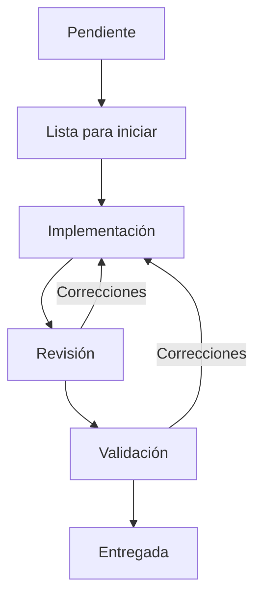
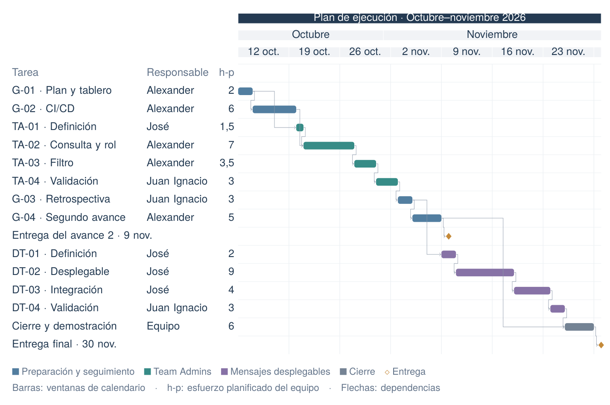

# Entregable 2: Proceso y plan de ejecución de mejoras en Mattermost

**Universidad CENFOTEC, Maestría Profesional en Ingeniería del Software**\
**Curso:** PSWE-07, Procesos y Administración de Software, C3 2026\
**Docente:** Shirley Ramírez Cordero\
**Grupo:** Grupo 01\
**Integrantes:** Alexander Gatica (`agvor`), José Cisneros (`megachivo`) y Juan Ignacio González (`J-IgnacioGC`)\
**Entrega prevista:** 9 de noviembre de 2026

## 1. Contexto y alcance

Este documento complementa el [entregable 1](https://github.com/agvor/mattermost/blob/master/pswe-07-grupo01/entregable01/Entregable_1_Mattermost.md) y detalla las tareas, los responsables, el flujo de desarrollo, las prácticas de integración y entrega (CI/CD) y las métricas del proyecto. El propósito es implementar dos mejoras de Mattermost y evaluar el proceso de trabajo del equipo con evidencia [1, 2].

El incremento 1 corresponde a #37406: identificación y filtro de Team Admins. El incremento 2 corresponde a #38480: secciones desplegables en mensajes web. Para el segundo avance se prevé completar el incremento 1 y realizar su retrospectiva. El equipo seleccionará una mejora de proceso para aplicarla y medirla en el incremento 2.

La base funcional es Mattermost Team Edition `12.0.0-dev`, commit `53211e45b6e63e99a5cc64d1ce1b344e3b64cc51`, en el [fork del grupo](https://github.com/agvor/mattermost). Las referencias de trabajo son la [guía de ambiente](https://github.com/agvor/mattermost/blob/master/pswe-07-grupo01/SETUP_MATTERMOST.md), la evidencia inicial de [#37406](https://github.com/agvor/mattermost/blob/master/pswe-07-grupo01/evidencia-base/issue-37406/README.md) y [#38480](https://github.com/agvor/mattermost/blob/master/pswe-07-grupo01/evidencia-base/issue-38480/README.md), y los criterios TA-01 a TA-03, DT-01 a DT-04 y RG-01 del primer avance [6].

## 2. Historias, tareas y responsables

El plan se organiza en tres historias: preparación y seguimiento (G), identificación de Team Admins (TA) y secciones desplegables (DT). La primera reúne el trabajo necesario para desarrollar y evaluar las dos mejoras funcionales. Cada historia tiene cuatro tareas con un resultado verificable.

Cada tarea tendrá un responsable que realiza el trabajo, un revisor que comprueba el cambio y un validador que verifica su aceptación. Los tres roles se asignan a personas distintas; cualquier cambio se registrará en la incidencia (*issue*). Cada tarea incluye sus pruebas y documentación.

Los identificadores de las tablas son códigos del plan. Los números de las incidencias se añadirán al crearlas en el fork. Los criterios de aceptación usan los códigos del entregable 1 y se citan como criterios.

### 2.1. Historia G: preparar y evaluar el proceso

Como equipo, queremos contar con un ambiente reproducible, un flujo de trabajo y registros de ejecución para entregar las mejoras y evaluar nuestro proceso.

*Tabla 1. Tareas y responsables de preparación y evaluación del proceso.*

| ID | Tarea y resultado esperado | Responsable | Revisor | Validador | Depende de |
|---|---|---|---|---|---|
| G-01 | Preparar el plan y el tablero. Actualizar la guía del ambiente, cargar historias y tareas con sus roles y definir el registro de eventos y esfuerzo. Comprobar el acceso del equipo y el marcador de identificación de cada tarea según el anexo A. Verificar los cálculos con un historial de prueba que incluya devolución y bloqueo; excluirlo de las métricas reales. | Alexander | José | Juan Ignacio | Base del entregable 1 |
| G-02 | Preparar CI/CD para los componentes afectados. Configurar los controles necesarios de los PR y de `master`, activar las métricas y documentar el despliegue manual y la recuperación de la versión anterior. Conservar una ejecución exitosa, un fallo controlado y una comprobación del despliegue con su SHA. | Alexander | José | Juan Ignacio | G-01 |
| G-03 | Evaluar el incremento 1. Calcular las métricas, analizar las esperas y realizar la retrospectiva. Acordar una mejora de proceso, su responsable y el indicador esperado para el incremento 2. José reproduce los cálculos. | Juan Ignacio | Alexander | José | TA-04 |
| G-04 | Consolidar el segundo avance. Actualizar el plan, la arquitectura, los riesgos, los costos y las dificultades con la evidencia disponible. Comprobar enlaces y versiones, preparar el PDF y acordar la coevaluación. | Alexander | José | Juan Ignacio | G-03 |

G-01 tendrá revisión y validación manual mientras se configura CI. G-02 se comprobará con la base funcional; el despliegue se repetirá con la versión del incremento 1. La historia G se cerrará al reunir los artefactos y la evidencia exigidos para el segundo avance.

### 2.2. Historia TA: descubrir administradores del equipo (#37406)

Como miembro de un equipo, quiero identificar y filtrar sus Team Admins para saber a quién acudir sin necesitar acceso a la System Console.

La historia se aceptará cuando la etiqueta y el filtro reflejen la membresía real, funcionen con la búsqueda y la paginación y respeten los permisos. Debe cumplir los criterios TA-01 a TA-03 y conservar el comportamiento de las listas existentes, según el criterio RG-01.

*Tabla 2. Tareas y responsables del incremento de identificación de Team Admins.*

| ID | Tarea y resultado esperado | Responsable | Revisor | Validador | Depende de |
|---|---|---|---|---|---|
| TA-01 | Definir la solución y los casos de aceptación. Localizar la lista de miembros y su API, acordar la etiqueta y el filtro, y describir los casos por rol, búsqueda, paginación y resultados vacíos. | José | Alexander | Juan Ignacio | G-01 |
| TA-02 | Resolver la consulta y la identificación del rol. Reutilizar la API o ajustarla si es necesario y mostrar la etiqueta según la membresía real. Probar permisos y distinguir un System Admin de un Team Admin del equipo consultado. | Alexander | José | Juan Ignacio | TA-01, G-02 |
| TA-03 | Incorporar el filtro web. Combinarlo con la búsqueda y reiniciar la paginación al cambiarlo. Probar administradores en páginas posteriores, resultados vacíos y el comportamiento de la lista sin filtro. | Alexander | José | Juan Ignacio | TA-02 |
| TA-04 | Validar y entregar el incremento. Ejecutar el recorrido completo por roles, agregar las pruebas E2E pertinentes y guardar capturas comparables del antes y el después. Comprobar el despliegue y documentar la versión entregada. José reproduce el recorrido. | Juan Ignacio | Alexander | José | TA-03 |

### 2.3. Historia DT: contraer contenido de mensajes (#38480)

Como persona que publica o lee información extensa, quiero una sección con resumen visible y contenido desplegable para consultar detalles sin desplazar toda la conversación.

La historia incluirá secciones no anidadas con párrafos y código. Debe funcionar de forma consistente en la vista previa, la publicación y la edición, admitir el uso del teclado y producir una salida segura, según los criterios DT-01 a DT-04 y RG-01.

*Tabla 3. Tareas y responsables del incremento de secciones desplegables.*

| ID | Tarea y resultado esperado | Responsable | Revisor | Validador | Depende de |
|---|---|---|---|---|---|
| DT-01 | Definir la sintaxis y los casos de aceptación. Localizar el analizador y los renderizadores; acordar ejemplos válidos, incompletos y no admitidos, el estado inicial y la variante `open`. Incorporar la mejora de proceso elegida en G-03. | José | Juan Ignacio | Alexander | G-03 |
| DT-02 | Implementar la sección desplegable. Reconocer el resumen y el cuerpo sin habilitar HTML arbitrario, representar párrafos y código y permitir abrir y cerrar con teclado. Probar la variante `open`, el foco, el estado accesible y las entradas inválidas o maliciosas. | José | Juan Ignacio | Alexander | DT-01 |
| DT-03 | Integrar los recorridos del mensaje. Usar la sección en vista previa, publicación y edición. Agregar pruebas de consistencia entre esas vistas y de regresión de mensajes ordinarios. | José | Juan Ignacio | Alexander | DT-02 |
| DT-04 | Validar y entregar el incremento. Ejecutar los casos funcionales, de accesibilidad y de salida segura, agregar las pruebas E2E pertinentes y guardar evidencia del antes y el después. Alexander reproduce los casos en la versión integrada. | Juan Ignacio | José | Alexander | DT-03 |

Los defectos encontrados durante la revisión o la validación se corregirán en la tarea de origen. TA-04 y DT-04 comprobarán el resultado conjunto de cada incremento. Una historia se cerrará cuando todas sus tareas estén entregadas y se hayan cumplido sus criterios de aceptación.

El alcance comprende la interfaz web. Se excluyen nuevos roles o permisos, el rediseño de la System Console, los directorios entre equipos y los clientes móviles nativos. En mensajes se excluyen secciones anidadas, adjuntos dentro de ellas, persistencia del estado abierto o cerrado y compatibilidad completa con el Markdown de GitHub. Los ajustes de alcance deberán justificarse y registrarse en el plan.

## 3. Asignación y ejecución en GitHub Projects

El trabajo seguirá el flujo de la figura 1. Cada tarea conservará su historial de devoluciones y bloqueos.



*Figura 1. Flujo de desarrollo previsto, con revisión, validación y devoluciones.*

La etapa Revisión incluye la espera y la revisión del trabajo. Validación incluye la espera, las pruebas de aceptación y la comprobación de la versión integrada.

### 3.1. Organización de las incidencias

El tablero se llamará PSWE-07 Grupo 01: Ejecución. Tendrá tres incidencias principales en el fork, una por historia: G, TA y DT. Cada tarea de las tablas se registrará como una subincidencia (*sub-issue*) de GitHub [3]. Las historias TA y DT enlazarán las incidencias originales de Mattermost. Las incidencias principales servirán para consultar el progreso; la medición se realizará sobre sus tareas.

Alexander cargará las incidencias en G-01. Cada tarea tendrá una sola persona asignada en Assignee, según la tabla. Los campos Revisor y Validador permitirán seleccionar a Alexander, José o Juan Ignacio; Grupo permitirá elegir G, TA o DT [4]. También se registrarán el estado, la fecha objetivo, la estimación y el esfuerzo real en horas-persona. La descripción incluirá el marcador de identificación del anexo A, los criterios de aceptación, las dependencias y los enlaces al *pull request* (PR) y a la evidencia.

La vista Flujo agrupará las tareas por estado. La vista Plan mostrará historias, tareas, responsables y fechas. Cada PR se enlazará en su tarea. El responsable seguirá asignado durante todo el proceso; el revisor y el validador consultarán sus tareas en el tablero.

### 3.2. Estados y responsables de cada transición

*Tabla 4. Estados, responsables y condiciones de transición del flujo de trabajo.*

| Estado | Quién registra la entrada | Condición |
|---|---|---|
| Pendiente | Alexander al cargar el backlog | La tarea tiene sus roles asignados y la etiqueta inicial `flujo:pendiente`. |
| Lista para iniciar | Responsable, de acuerdo con revisor y validador | Alcance, criterios de aceptación y estimación acordados; dependencias entregadas. |
| Implementación | Responsable | Comienza el trabajo o retoma una corrección. |
| Revisión | Responsable | Presenta el resultado y el PR con las pruebas y la evidencia. |
| Validación | Revisor | Aprueba el trabajo y comprueba CI. El validador verifica los criterios de aceptación. |
| Entregada | Validador | Acepta el resultado, comprueba la versión integrada y vincula la evidencia. Añade la etiqueta de entrega y cierra la incidencia. |

Las condiciones de Lista para iniciar corresponden a la *Definition of Ready* del primer entregable. Una tarea cumple la *Definition of Done* al contar con revisión aprobada, pruebas pertinentes exitosas, evidencia vinculada, documentación actualizada y comprobación de la versión integrada.

Trabajo en curso (WIP). Se permitirá como máximo una tarea en Implementación, una en Revisión y una en Validación. El equipo controlará estos límites y priorizará terminar las tareas iniciadas. Una tarea podrá comenzar cuando sus dependencias estén Entregadas.

Quien solicite correcciones devolverá la tarea a Implementación y explicará el motivo con evidencia. Para registrar un bloqueo, añadirá la etiqueta `bloqueada` y documentará quién debe resolverlo. Retirará la etiqueta cuando se resuelva. Durante el bloqueo, la tarea conservará su etapa y contará dentro del límite de trabajo en curso.

El validador cerrará la incidencia después de comprobar la versión integrada. El equipo desactivará los cierres automáticos desde PR y las automatizaciones de Projects que adelanten el estado Entregada [5].

### 3.3. Registro de transiciones y métricas

Cada integrante registrará los cambios de etapa añadiendo la etiqueta `flujo:*` correspondiente en la incidencia. Esperará a que termine la sincronización antes del siguiente cambio en esa tarea. El revisor añadirá `revision:iniciada` al comenzar su primera revisión y la conservará durante las correcciones. Los comentarios documentarán decisiones, motivos de devolución o bloqueo y enlaces al PR, las pruebas y el SHA validado.

El workflow `.github/workflows/pswe07-proceso.yml` retirará las etiquetas de etapas anteriores y actualizará Status en Projects. Usará la fecha, el actor y el identificador de cada evento del historial de GitHub [8, 9]. El script `metricas.py` generará el historial, los valores por tarea y el resumen de métricas en archivos JSON, CSV y Markdown. El anexo A reúne las etiquetas y las instrucciones de configuración y consulta.

La medición se ejecutará al cambiar etiquetas, cerrar o reabrir incidencias, además de una ejecución semanal y la opción manual. Juan Ignacio conservará una copia de los reportes utilizados en cada entrega. Cada integrante registrará sus horas efectivas por persona, actividad y minutos trabajados.

El script cuenta con pruebas locales. La activación y la comprobación en GitHub se realizarán en G-02. El enlace al tablero y los números de las incidencias se incorporarán al documento durante la configuración.

## 4. CI/CD, revisión y pruebas

La rama de integración será `master` del fork del grupo. Cada tarea partirá de su versión actual y usará una rama breve con el prefijo `pswe07/` y su identificador, por ejemplo, `pswe07/G-03`, `pswe07/TA-02` o `pswe07/DT-03`. Se registrará el SHA de partida para relacionar el cambio con la base documentada.

Los PR se dirigirán a `master` del mismo fork, seguirán la plantilla del repositorio y enlazarán la tarea, sus criterios, las pruebas y la evidencia. La integración requerirá revisión aprobada, controles exitosos y validación del resultado. Después se comprobará la versión integrada y se eliminará la rama de la tarea. Los enlaces al PR y a sus commits permanecerán en la incidencia.

En G-02 se reutilizarán los controles aplicables de los flujos de [webapp](https://github.com/agvor/mattermost/blob/master/.github/workflows/webapp-ci.yml) y [servidor](https://github.com/agvor/mattermost/blob/master/.github/workflows/server-ci.yml), adaptando los necesarios para ejecutarlos en el fork. Se limitarán a los componentes modificados y sus dependencias; los servicios de publicación y las integraciones propias del repositorio oficial quedan fuera del alcance académico. Los controles se ejecutarán en los PR a `master` y al integrar los cambios, con resultados identificados por SHA.

*Tabla 5. Verificaciones mínimas de integración y pruebas según el tipo de cambio.*

| Tipo de cambio | Verificación mínima |
|---|---|
| Documentación y proceso | Coherencia con la consigna, enlaces válidos y reproducción de las instrucciones por el validador. |
| Web | Instalación según el archivo de dependencias bloqueadas, lint, tipos, pruebas unitarias y de componentes afectados, y compilación web. Regresión de los componentes compartidos modificados. |
| Servidor y API | Si cambia el servidor: formato y controles de Go, pruebas de los paquetes afectados, consulta y permisos, integración con PostgreSQL cuando corresponda y compilación. |
| Incremento completo | Pruebas E2E de los criterios de aceptación y validación por roles o recorridos del mensaje. Comprobación del ambiente con web y servidor sobre la misma versión; se reutilizará el servidor base si no cambia. |

Un control fallido impedirá integrar el cambio. Una ejecución omitida no contará como prueba realizada. Los fallos y las devoluciones se corregirán en la misma tarea; si hay cambios relevantes después de la aprobación, se revisará y validará de nuevo el SHA actualizado.

El despliegue será manual al ambiente académico, con artefactos identificados por SHA y recuperación documentada de la última versión validada. G-02 comprobará la respuesta del servidor y un recorrido funcional. Juan Ignacio probará las instrucciones y José revisará la configuración de Alexander. Las pruebas y los reportes se vincularán a la tarea y se conservarán hasta la defensa.

Los ajustes del proceso también se versionarán: cada cambio en estados, roles, límites de trabajo o controles tendrá motivo, fecha de aplicación e indicador esperado en su incidencia y PR. Si afecta Actions, el PR incluirá el cambio en `.github/workflows/` y el enlace a una ejecución que lo compruebe. La mejora seleccionada en G-03 enlazará esos registros para comparar el proceso anterior y el ajustado.

## 5. Calendario y seguimiento

La capacidad prevista se mantiene en 4 horas semanales por integrante, 12 horas-persona para el equipo. Las fechas de la tabla son objetivos de trabajo. La sección 9 presenta la estimación inicial de esfuerzo mediante PERT. Antes de pasar una tarea a Lista para iniciar, el equipo revisará sus supuestos según el análisis técnico disponible. Si el esfuerzo supera la capacidad, el equipo dividirá las tareas o ajustará las fechas de trabajo y el alcance dentro de las exclusiones acordadas, sin eliminar revisiones ni pruebas [2].

*Tabla 6. Calendario de tareas e hitos del proyecto.*

| Periodo de 2026 | Tareas e hitos |
|---|---|
| Del 12 al 18 de octubre | G-01 e inicio de G-02: plan, tablero y controles del fork. |
| Del 19 al 25 de octubre | Fin de G-02, TA-01 e inicio de TA-02: definición, consulta y rol. |
| Del 26 de octubre al 1 de noviembre | Fin de TA-02, TA-03 e inicio de TA-04: filtro y validación. |
| Del 2 al 8 de noviembre | Fin de TA-04, G-03 y G-04: retrospectiva y segundo avance. |
| 9 de noviembre | Entregable 2. |
| Del 9 al 15 de noviembre | DT-01 e inicio de DT-02 con el proceso ajustado. |
| Del 16 al 22 de noviembre | Fin de DT-02 e inicio de DT-03: integración de los recorridos. |
| Del 23 al 29 de noviembre | Fin de DT-03, DT-04, comparación de métricas y preparación de la demostración. |
| 30 de noviembre | Entrega y demostración final. |


*Tabla 7. Distribución semanal prevista, en horas-persona.*

| Semana de 2026 | Alexander | José | Juan Ignacio | Total |
|---|---:|---:|---:|---:|
| 12 al 18 de octubre | 4 | 1,25 | 1,25 | 6,5 |
| 19 al 25 de octubre | 4 | 1,75 | 1,25 | 7 |
| 26 de octubre al 1 de noviembre | 4 | 1,5 | 2 | 7,5 |
| 2 al 8 de noviembre | 3,75 | 2,75 | 3,5 | 10 |
| 9 al 15 de noviembre | 1,5 | 4 | 1,25 | 6,75 |
| 16 al 22 de noviembre | 1,5 | 4 | 1,25 | 6,75 |
| 23 al 29 de noviembre | 3,5 | 3 | 4 | 10,5 |
| Total planificado | 22,25 | 18,25 | 14,5 | 55 |

El anexo B detalla el reparto por tarea y rol. El cierre asigna dos horas a cada integrante. Antes de iniciar las tareas se revisará la carga semanal; el uso de contingencia deberá caber en la disponibilidad restante o requerirá reprogramación. La capacidad libre no es esfuerzo presupuestado.

El Gantt muestra ventanas de calendario, responsables, esfuerzo total por tarea y dependencias. Las horas incluyen el aporte de los tres roles y no equivalen a jornadas de trabajo.



*Figura 2. Gantt de tareas, responsables, esfuerzo estimado, dependencias e hitos del proyecto.*

Fuente editable: [plan-gantt.tex](plan-gantt.tex).

## 6. Métricas del proceso

Se medirán la duración total del trabajo, la espera de revisión y la aceptación sin retrabajo. La clase 02, diapositivas 7 a 9, explica el lead time, los resultados sin reproceso y la espera en la cola de revisión como elementos para evaluar y mejorar el flujo [2].

Las métricas se calcularán sobre las tareas TA y DT, por incremento y tipo de trabajo: definición, implementación o validación integral. La comparación principal usará TA-02 y TA-03 frente a DT-02 y DT-03. Al contar con solo dos tareas de implementación por incremento, se mostrarán sus valores individuales y las diferencias de tamaño y complejidad. Las tareas G se reportarán aparte. Se medirán las incidencias etiquetadas `pswe07` y `tipo:tarea`; se excluirán las etiquetadas `pswe07:prueba`.

*Tabla 8. Métricas del proceso, cálculo y metas iniciales.*

| Métrica | Fuente y cálculo | Meta inicial |
|---|---|---|
| *Lead time* | Historial de etiquetas: tiempo desde la primera entrada a Lista para iniciar hasta la primera entrada a Entregada, incluidas las esperas, los bloqueos y las devoluciones. Se reporta la mediana por incremento. | Mediana de 5 días hábiles o menos. |
| Espera de revisión | Historial de etiquetas: tiempo desde la primera entrada a Revisión hasta la primera adición posterior de `revision:iniciada`, cuando el revisor comienza a trabajar. | Al menos el 80 % de las tareas en 2 días hábiles o menos. |
| Aceptación sin retrabajo (%CA) | `100 × tareas aceptadas en la primera validación / tareas con primera validación concluida`. La primera salida de Validación hacia Entregada cuenta como aceptación; hacia Implementación, como rechazo. Las salidas ambiguas se señalan para revisión y se excluyen del porcentaje hasta aclararlas. | 80 % o más. |

Las fechas y horas se registrarán en formato ISO 8601, con la zona `America/Costa_Rica` (UTC-06:00). Para evaluar las metas se contará el tiempo de lunes a viernes, excluyendo los fines de semana; cada 24 horas acumuladas en esos días equivaldrá a un día hábil. Los feriados se incluirán en el cálculo. El esfuerzo efectivo se registrará aparte, según las sesiones de trabajo.

Juan Ignacio revisará los valores por tarea, el número de observaciones y los denominadores de los porcentajes. El reporte incluirá las tareas abiertas con su antigüedad o espera acumulada, las reaperturas y los datos pendientes de revisión. El cálculo usará las fechas reales del historial de GitHub, la primera entrada a cada etapa medida y el resultado de la primera validación.

En G-03, el equipo usará los registros para representar el flujo observado, identificar las esperas y seleccionar una mejora medible. Ambos incrementos usarán estas definiciones. La comparación considerará las diferencias técnicas y el tamaño reducido de la muestra, sin atribuir causalidad cuando falte evidencia.

## 7. Evidencia, arquitectura y estado del avance

La evidencia disponible comprende el entregable 1, la guía del ambiente y las capturas del comportamiento inicial. El tablero, los PR de las mejoras, los reportes de CI y las mediciones se incorporarán conforme se ejecuten las tareas.

Cada tarea vinculará la historia, los criterios de aceptación, el PR y sus commits, la revisión, los controles de CI, la validación y la entrega. Las capturas indicarán el SHA, el rol de usuario, los pasos y el resultado. Las dificultades y los ajustes se registrarán en la incidencia y se resumirán en el seguimiento semanal. Una comprobación prevista en G-02 es determinar si los flujos originales dependen de secretos o condiciones que requieran adaptación en el fork.

En G-04 se revisará el [C4 de contexto](https://github.com/agvor/mattermost/blob/master/pswe-07-grupo01/entregable01/arquitectura-c4-contexto.mmd) y se añadirá la vista necesaria para explicar los componentes modificados de la lista de miembros y la API. Los diagramas incluirán su fuente Mermaid y una representación visual. Los cambios del analizador y los renderizadores se documentarán al desarrollar el incremento 2. La arquitectura de la implementación está pendiente.

## 8. Riesgos

El análisis utiliza la matriz cualitativa de probabilidad e impacto presentada en la clase 06 [2]. La escala elegida para este proyecto es de 1 a 3. En probabilidad, 1 significa poco probable bajo los controles previstos; 2, posible por la incertidumbre técnica o de coordinación; y 3, probable ante señales concretas. En impacto, 1 corresponde a una corrección local sin comprometer un hito o criterio de aceptación; 2, a una replanificación o evidencia incompleta; y 3, a comprometer una entrega, los permisos o la seguridad del contenido. La prioridad es el producto: baja de 1 a 2, media de 3 a 4 y alta de 6 a 9.

La valoración inicial se basa en el alcance acotado, el ambiente ya reproducido y las responsabilidades acordadas. No se interpreta como una frecuencia estadística: se revisará semanalmente y en la retrospectiva. Las razones de cada valoración se explican a continuación.

*Tabla 9. Valoración inicial de los riesgos y responsables de seguimiento.*

| ID y riesgo | Probabilidad / impacto / prioridad | Razón de la valoración | Responsable |
|---|---|---|---|
| R1. La consulta omite administradores o expone datos sin permiso. | 2 / 3 / 6, alta | Combinar membresías, búsqueda y paginación puede producir omisiones. Se reutilizarán permisos existentes, pero cualquier exposición indebida impediría aceptar la mejora. | Alexander |
| R2. La sección desplegable admite contenido inseguro o difiere entre vistas. | 2 / 3 / 6, alta | La extensión del analizador y su uso en tres recorridos requieren comprobación conjunta. La sintaxis limitada reduce la superficie del cambio; una salida insegura impediría entregar. | José |
| R3. Actions requiere servicios o secretos no disponibles en el fork. | 2 / 2 / 4, media | Los flujos originales pueden depender del ambiente del proyecto oficial. La adaptación se hará antes del desarrollo funcional, pero podría requerir reprogramar su inicio. | Alexander |
| R4. Revisiones o retrabajo exceden la disponibilidad del equipo. | 2 / 2 / 4, media | Cada integrante dispone de cuatro horas semanales y participa en distintos roles. Las tareas pequeñas y el límite de trabajo en curso ayudan, aunque una espera puede desplazar tareas dependientes. | Juan Ignacio |
| R5. Faltan eventos o evidencia para reproducir las métricas. | 1 / 2 / 2, baja | Hay un responsable del registro y una revisión semanal prevista, por lo que se considera poco probable con esos controles. Si ocurre, limita la comparación del proceso. | Juan Ignacio |

*Tabla 10. Señales de activación y respuestas previstas para los riesgos.*

| Riesgo | Señal de activación | Respuesta prevista |
|---|---|---|
| R1 | Falla un caso por rol, búsqueda o administradores en páginas posteriores. | Mitigar con consulta sobre el conjunto completo y pruebas de permisos; corregir y repetir los casos antes de entregar. |
| R2 | Falla una entrada maliciosa o cambia el resultado entre vista previa, publicación y edición. | Mitigar con sintaxis acotada, salida segura y pruebas comunes; corregir el analizador o la integración y volver a validar. |
| R3 | Un control requerido no puede ejecutarse en G-02. | Adaptar el flujo a los servicios disponibles, registrar el bloqueo y comprobar la solución mediante Actions. Una ejecución omitida no sustituye una prueba. |
| R4 | La espera de revisión supera dos días hábiles o el esfuerzo pendiente excede la capacidad hasta el hito. | Acordar un horario de revisión, terminar el trabajo iniciado y ajustar fechas y asignaciones, conservando los criterios de aceptación. |
| R5 | La revisión semanal detecta una tarea sin eventos, SHA o resultados. | Completar el registro a partir de evidencia verificable; declarar los datos irrecuperables y su efecto en las métricas. |

La contingencia será global, del 10 % del esfuerzo pendiente, para trabajo adicional por riesgos identificados que no esté incluido en PERT. Cada activación registrará fecha, acción, esfuerzo y resultado en su incidencia. Los fallos de permisos o de salida segura impedirán entregar hasta corregirlos; si comprometen un hito, se revisará el plan.

## 9. Costos

### 9.1. Alcance y supuestos

El presupuesto cubre todo el proyecto: preparación del entregable 1, ejecución de ambos incrementos y cierre del 30 de noviembre. Se valorará el trabajo mediante una tarifa hipotética de ₡5.000 por hora-persona, uniforme para los tres integrantes. Es una referencia académica de costo de oportunidad, sin remuneraciones previstas ni pretensión de representar una tarifa de mercado.

La disponibilidad prevista es de cuatro horas semanales por integrante, doce horas-persona para el equipo. El ambiente se ejecutará con Docker en equipos propios. Se contabilizarán únicamente los gastos adicionales atribuibles al proyecto; no se imputarán depreciación del equipo, electricidad o suscripciones ya disponibles sin gasto adicional.

### 9.2. Método y estimación del esfuerzo

La estimación inicial revisada combina dos técnicas de la clase 05: estimación de abajo hacia arriba, que suma el esfuerzo de actividades delimitadas, y estimación de tres puntos mediante PERT, que pondera la incertidumbre.

Para cada tarea se define un esfuerzo optimista (O), más probable (M) y pesimista (P). M representa el escenario considerado más razonable. El esfuerzo esperado se calcula como:

```text
E = (O + 4 × M + P) / 6
H = (entero superior de 2 × E) / 2, calculado por tarea
Costo planificado = H × ₡5.000
```

El esfuerzo PERT se redondea hacia arriba al siguiente múltiplo de 0,5 horas por tarea. La columna E muestra el cálculo y Plan, las horas utilizadas en el calendario y presupuesto. Las estimaciones incluyen ejecución, pruebas, documentación, revisión, validación y seguimiento. Son una base de planificación pendiente de confirmar al analizar cada tarea, no horas ya trabajadas.

*Tabla 11. Estimación PERT y esfuerzo planificado por tarea, en horas-persona.*

| Tarea | O | M | P | E | Plan | Fundamento de los escenarios |
|---|---:|---:|---:|---:|---:|---|
| G-01 | 1 | 2 | 3 | 2,00 | 2 | Reutilizar el plan y la guía; cargar el tablero, comprobar marcadores y verificar el registro. |
| G-02 | 3 | 5 | 11 | 5,67 | 6 | Configurar controles y métricas, probar despliegue y recuperación; puede haber ajustes de servicios o permisos. |
| G-03 | 2 | 3 | 4 | 3,00 | 3 | Calcular y reproducir métricas, realizar la retrospectiva y acordar una mejora. |
| G-04 | 3 | 4,5 | 8 | 4,83 | 5 | Consolidar evidencia, actualizar arquitectura y documentos, revisar y exportar el PDF. |
| TA-01 | 1 | 1,5 | 2 | 1,50 | 1,5 | Precisar componentes y casos a partir de la aceptación existente. |
| TA-02 | 4 | 6,5 | 12 | 7,00 | 7 | Seguir la consulta y la membresía, implementar la etiqueta y probar permisos; podría requerir cambios de API. |
| TA-03 | 2 | 3 | 7 | 3,50 | 3,5 | Integrar filtro, búsqueda y paginación, con pruebas de regresión. |
| TA-04 | 2 | 3 | 4 | 3,00 | 3 | Verificar el recorrido integrado, las pruebas E2E y la evidencia de entrega. |
| DT-01 | 1 | 2 | 3 | 2,00 | 2 | Localizar analizador y vistas, definir ejemplos y aplicar la mejora de proceso. |
| DT-02 | 5 | 8 | 17 | 9,00 | 9 | Implementar sintaxis y representación; probar teclado y entradas inválidas. El mayor riesgo es la integración con el analizador. |
| DT-03 | 2 | 4 | 6 | 4,00 | 4 | Integrar vista previa, publicación y edición, con pruebas compartidas y de regresión. |
| DT-04 | 2 | 3 | 4 | 3,00 | 3 | Validar el incremento, completar E2E y reproducir los casos sobre la versión integrada. |
| Total de las doce tareas | 28 | 45,5 | 81 | 48,50 | 49 | Plan redondeado por tarea. |

Por ejemplo, `(3 + 4 × 5 + 11) / 6` da aproximadamente 5,67 h-p para G-02, que se redondean a 6. Las doce tareas suman 48,5 h-p mediante PERT y 49 después del redondeo. Se añaden 6 h-p para comparación final de métricas, documentación, demostración y ensayo. Un cambio mayor en la API o el analizador requerirá reestimar antes de continuar.

### 9.3. Recursos y presupuesto

*Tabla 12. Recursos, gastos adicionales previstos y condiciones de uso.*

| Recurso | Gasto adicional previsto | Condición y seguimiento |
|---|---:|---|
| Equipos propios y Docker | ₡0 | No se contratará infraestructura; se registrará cualquier gasto adicional que llegue a requerirse. |
| GitHub Actions y artefactos | ₡0 | Se prevé utilizar las opciones incluidas. GitHub documenta ejecución gratuita con runners estándar en repositorios públicos [7]. |
| Herramientas de IA y otras herramientas disponibles | ₡0 | Se utilizarán sin adquirir suscripciones adicionales para este proyecto. |

Los valores de ₡0 corresponden a gastos adicionales previstos. Alexander comprobará las condiciones de Actions, el consumo y la retención de artefactos en G-02. Cualquier cargo previsto requerirá actualizar el presupuesto antes de incurrir en él.

*Tabla 13. Presupuesto del proyecto y reserva de contingencia.*

| Componente | Horas-persona | Valoración académica |
|---|---:|---:|
| Doce tareas del plan, redondeadas por tarea | 49 | ₡245.000 |
| Cierre final | 6 | ₡30.000 |
| Subtotal de trabajo pendiente | 55 | ₡275.000 |
| Contingencia del 10 % sobre el trabajo pendiente | 5,5 | ₡27.500 |
| Trabajo pendiente con contingencia | 60,5 | ₡302.500 |
| Preparación del entregable 1, estimación retrospectiva | 6 | ₡30.000 |
| Gastos adicionales previstos | — | ₡0 |
| Total del proyecto con contingencia | 66,5 | ₡332.500 |

El costo base es `(6 + 49 + 6) × ₡5.000 = ₡305.000`; con contingencia, la línea base queda en ₡332.500 y la reserva de gestión en ₡0. Las seis horas del primer avance son la estimación retrospectiva ya utilizada, sin registro detallado de sesiones; se contabilizan por separado de G-01. La contingencia se calcula sobre las 55 horas pendientes, sin aplicar el redondeo de tareas a la reserva.

### 9.4. Control y estado real

Juan Ignacio consolidará las horas de ejecución, revisión y validación por tarea; Alexander registrará los recursos y cualquier desembolso adicional; José revisará el uso de la contingencia. La estimación al cierre será el esfuerzo consumido más el esfuerzo pendiente, valorados a la misma tarifa, más los gastos adicionales atribuibles.

El equipo revisará el plan si la proyección supera en más del 20 % el costo base de todo el proyecto: más de ₡366.000 (`₡305.000 × 1,20`). Si la variación corresponde solo a esfuerzo, equivale a superar 73,2 horas-persona. El cálculo también incluirá cualquier gasto adicional. Superar este umbral requerirá revisar el plan y la reserva disponible de 5,5 horas. Se revisará antes si la proyección agota la contingencia, supera la capacidad semanal, compromete una entrega o falla un criterio de permisos o seguridad.

## 10. Coevaluación

Las notas y las justificaciones se acordarán entre los tres integrantes según los aportes realizados y se completarán para la entrega del segundo avance.

*Tabla 14. Coevaluación y justificación de los aportes del equipo.*

| Integrante | Nota sugerida | Aporte y justificación |
|---|---|---|
| Alexander Gatica (`agvor`) | 100 | N/A |
| José Cisneros (`megachivo`) | 100 | N/A |
| Juan Ignacio González (`J-IgnacioGC`) | 100 | N/A |

## 11. Referencias y uso de IA

1. Ramírez Cordero, S. *Consigna general de entregables 1, 2 y final del proyecto del curso*. CENFOTEC, C3 2026, pp. 1 a 2 y 6 a 7.
2. Ramírez Cordero, S. *Fundamentos de procesos*; *Modelado de procesos, VSM, evaluación y medición*; *Enfoques de gestión de proyectos de tecnología*; *Planificación y estimación de proyectos de software*; *Gestión de costos de proyectos de tecnología*; *Gestión de riesgos de proyectos de tecnología*. Presentaciones del curso, C3 2026.
3. GitHub Docs. [Adding sub-issues](https://docs.github.com/en/issues/tracking-your-work-with-issues/using-issues/adding-sub-issues).
4. GitHub Docs. [About single select fields](https://docs.github.com/en/issues/planning-and-tracking-with-projects/understanding-fields/about-single-select-fields).
5. GitHub Docs. [Using the built-in automations](https://docs.github.com/en/issues/planning-and-tracking-with-projects/automating-your-project/using-the-built-in-automations).
6. Grupo 01. Entregable 1, guía del ambiente y evidencia base; Mattermost, workflows del repositorio.
7. GitHub Docs. [GitHub Actions billing](https://docs.github.com/en/billing/concepts/product-billing/github-actions). Condiciones de ejecución y almacenamiento consultadas para preparar el presupuesto.
8. GitHub Docs. [REST API endpoints for timeline events](https://docs.github.com/en/rest/issues/timeline). Historial de cambios en Issues.
9. GitHub Docs. [Events that trigger workflows](https://docs.github.com/en/actions/reference/workflows-and-actions/events-that-trigger-workflows). Eventos de Issues para ejecutar Actions.

Uso de IA. Codex se consultó como apoyo para revisar la planificación, la descomposición de tareas y la coherencia del flujo de trabajo y de CI/CD. Las sugerencias se contrastaron con la consigna, el primer entregable, el repositorio y la documentación oficial. El [registro de prompts](https://github.com/agvor/mattermost/blob/master/pswe-07-grupo01/entregable02/PROMPTS_USO_IA.md) reúne consultas generales y representativas en formato reutilizable. El equipo conserva la responsabilidad sobre las decisiones, la elaboración de los artefactos y la validación de los resultados.


## Anexo A. Configuración y uso de las métricas

### A.1. Identificación de tareas y etiquetas

Cada incidencia de tarea tendrá las etiquetas `pswe07` y `tipo:tarea` y este marcador en su descripción, sustituyendo TA-02 por su código del plan:

```html
<!-- pswe07:key=TA-02 -->
```

El script obtiene la tarea y el grupo (G, TA o DT) exclusivamente de ese marcador. El título y el campo Grupo del tablero no lo sustituyen. En G-01 se comprobará que cada código coincida con el plan y aparezca correctamente en `metricas.csv` y en el grupo correspondiente de `resumen.json`. Los historiales de prueba se verificarán aparte; las incidencias etiquetadas `pswe07:prueba` se excluyen de los reportes y de la sincronización.

En la incidencia, añadir la etiqueta de la etapa correspondiente desde Labels:

```text
Pendiente          flujo:pendiente
Lista para iniciar flujo:lista
Implementación     flujo:implementacion
Revisión           flujo:revision
Validación         flujo:validacion
Entregada          flujo:entregada
```

Actions retira las otras etiquetas de etapa y actualiza el tablero. Esperar a que termine antes del siguiente cambio en la misma tarea. El revisor añade `revision:iniciada` una sola vez al comenzar su primera revisión. Las devoluciones y los bloqueos se registran según la sección 3.2.

### A.2. Activación

La automatización requiere Python 3 y GitHub CLI, disponibles en el runner del workflow. El proyecto debe contener las historias, las tareas y los estados de la sección 3. Las incidencias deben estar habilitadas y los tres integrantes deben tener acceso al repositorio.

1. En Projects, conceder escritura a los integrantes. Agrupar la vista Flujo por Status y aplicar el filtro `label:"tipo:tarea"`. Desactivar las automatizaciones que adelanten Entregada o cierren incidencias antes de la validación.
2. Integrar en la rama predeterminada `.github/workflows/pswe07-proceso.yml` y los archivos `metricas.py`, `test_metricas.py` y `.gitignore` de `pswe-07-grupo01/github/`. Habilitar Actions en el fork.
3. En Settings → Secrets and variables → Actions, crear las variables `PSWE07_PROJECT_OWNER` con `agvor` y `PSWE07_PROJECT_NUMBER` con el número de la URL del proyecto. Crear el secreto `PSWE07_PROJECT_TOKEN` con un token personal clásico del propietario con alcance `project`. Guardarlo únicamente como secreto de Actions.
4. En Actions → PSWE-07 · Proceso y métricas, seleccionar Run workflow. Comprobar la ejecución y el acceso al proyecto. Verificar la sincronización durante las transiciones reales de las tareas; un reporte sin eventos mostrará “Sin datos”.

### A.3. Reportes y ejecución local

Cada ejecución publica un resumen y el artefacto `pswe07-metricas-<run_id>` con `eventos.json` (historial), `metricas.csv` (valores por tarea), `resumen.json` (métricas por grupo) y `reporte.md` (reporte legible). La retención solicitada es de 90 días, sujeta al límite de la cuenta.

Para obtener el reporte localmente, ejecutar desde `pswe-07-grupo01/github/` con una sesión autenticada de GitHub CLI:

```bash
python3 metricas.py
```

Para sincronizar también el tablero, usar el número real del proyecto y una sesión con acceso `project`:

```bash
python3 metricas.py --sync-project --project-owner agvor --project-number 1
```

Los reportes se guardan en `salida/`, excluida de Git. Para ejecutar las pruebas locales:

```bash
python3 -m unittest test_metricas -v
```


## Anexo B. Distribución del esfuerzo por tarea

Las horas corresponden a los roles asignados en las tablas 1 a 3; su suma es el esfuerzo Plan de la tabla 11. El responsable incluye implementación, pruebas, documentación y coordinación; el revisor y el validador incluyen sus comprobaciones y seguimiento. En las tareas que cruzan semanas, el signo + separa las horas de la primera y la segunda semana de su ventana. Esta distribución inicial se ajustará con las horas reales.

*Tabla 15. Esfuerzo previsto por rol, en horas-persona.*

| Código | Responsable | Revisor | Validador |
|---|---:|---:|---:|
| G-01 | 1 | 0,5 | 0,5 |
| G-02 | 3 + 1 | 0,75 + 0,25 | 0,75 + 0,25 |
| G-03 | 1,5 | 0,75 | 0,75 |
| G-04 | 3 | 1 | 1 |
| TA-01 | 0,75 | 0,5 | 0,25 |
| TA-02 | 2,5 + 1,5 | 0,75 + 0,75 | 0,75 + 0,75 |
| TA-03 | 2 | 0,75 | 0,75 |
| TA-04 | 0,5 + 1 | 0,5 + 0 | 0 + 1 |
| DT-01 | 1 | 0,5 | 0,5 |
| DT-02 | 3 + 2,5 | 0,75 + 0,75 | 1 + 1 |
| DT-03 | 1,5 + 0,5 | 0,5 + 0,5 | 0,5 + 0,5 |
| DT-04 | 1,5 | 0,5 | 1 |
