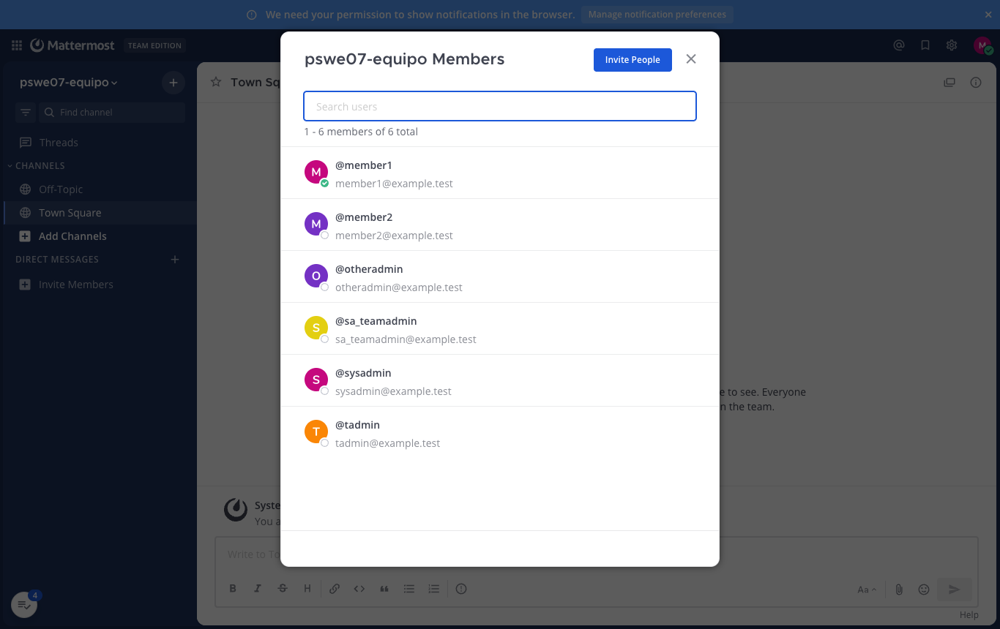

# Línea base de pruebas en macOS

Fecha de ejecución: **17 de octubre de 2026**, `America/Costa_Rica`
Responsable: José Cisneros (`megachivo`), como parte de la revisión de G-01

## 1. Identificación de la base

| Elemento | Valor verificado |
|---|---|
| Repositorio | `https://github.com/agvor/mattermost` |
| SHA ejecutado | `61b44aca77d23ae5e520a6c844c646e6b3f0f15c`, sin diferencias en `server/` ni `webapp/` respecto de `53211e45b6e63e99a5cc64d1ce1b344e3b64cc51` |
| Mattermost | `12.0.0` Team Edition |
| Sistema | macOS 26.7.1, `arm64` |
| Docker | Colima, 6 CPU y 12 GB; Docker 29.5.2, Compose 5.5.1 |
| Go / Node.js / npm | `1.26.7` / `24.11.1` / `11.6.2` |
| Ping | `status: OK` |

El ambiente se preparó según la [guía para macOS](../../SETUP_MATTERMOST_MACOS.md).

## 2. Resultados

*Tabla 1. Comprobaciones de la línea base.*

| Comprobación | Resultado |
|---|---|
| `npm ci` según el archivo bloqueado (1924 paquetes) y `npm run build` | OK, «Web app built!» |
| Compilación del servidor y de `mmctl` | OK |
| `make run-server` y `GET /api/v4/system/ping` | OK |
| Tipos (`tsc -b`) y lint (ESLint y Stylelint), todos los workspaces | OK |
| Jest completo con `--ci` en todos los workspaces | 15.084 aprobadas, 1 fallida (inestable) y 11 omitidas, de 15.096 |
| Suites relacionadas con TA y DT: lista de miembros, markdown, `text_formatting`, `message_html_to_component` y vistas del mensaje | 58 de 58 aprobadas |
| Servidor `api4`: `TestGetTeamMember`, `TestGetTeamMembers`, `TestGetTeamMembersRoleDataSanitization` (y sus variantes por ID y por usuario), `TestGetUsers`, `TestGetUsersInTeam`, `TestSearchUsers` y `TestGetFilteredUsersStats` | 9 de 9 aprobadas |
| Servidor `sqlstore` `TestUserStore` con `TZ=UTC` | 68 de 68 subpruebas aprobadas |

## 3. Fallos inestables observados

1. **`sidebar_channel_menu.test.tsx`**, "should show correct menu items when channel is read": el *snapshot* registró la transformación CSS del popover en plena transición (`scale(1, 1)` frente a `none`). Ejecutado de forma aislada, pasó 3 de 3 veces. No está relacionado con TA ni con DT.
2. **`TestUserStore/PostgreSQL/GetUserReport`** (esperado 3, obtenido 4): falló con la zona `America/Costa_Rica` a las 23:13, cuando en UTC ya era el día siguiente, y pasó con `TZ=UTC`. Por eso las pruebas del servidor se ejecutan con `TZ=UTC`.

## 4. Lista de miembros por rol (#37406)

Se creó el equipo `pswe07-equipo` con un System Admin, un Team Admin, dos miembros, un System Admin que también es Team Admin y un Team Admin de otro equipo. Los usuarios de prueba usan correos `@example.test`; sus contraseñas no se publican.

*Tabla 2. Opción del menú y etiquetas de rol según quien consulta.*

| Usuario | Opción del menú | Etiquetas de rol en la lista | Captura |
|---|---|---|---|
| Miembro | View members | Ninguna: los seis miembros aparecen sin rol | [01](capturas/01-miembro-view-members.png) |
| Team Admin | Manage members | Member, Team Admin y System Admin | [02](capturas/02-team-admin-manage-members.png) |
| System Admin | Manage members | Member, Team Admin y System Admin | [03](capturas/03-system-admin-manage-members.png) |

El Team Admin de otro equipo aparece como Member, que es lo correcto. Para un miembro, la lista no permite identificar a quién acudir, lo que confirma el estado inicial descrito en [la evidencia de #37406](../issue-37406/README.md).

*Figura 1. Lista de miembros del equipo vista por un miembro en la versión base.*
