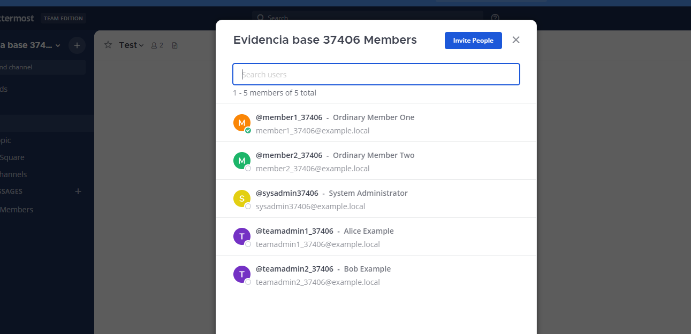
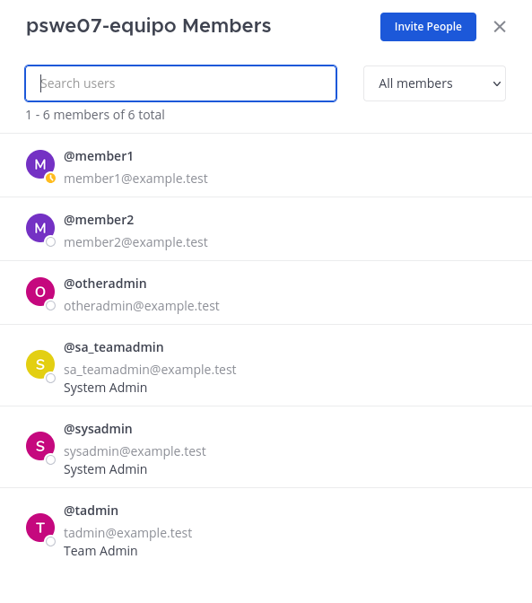
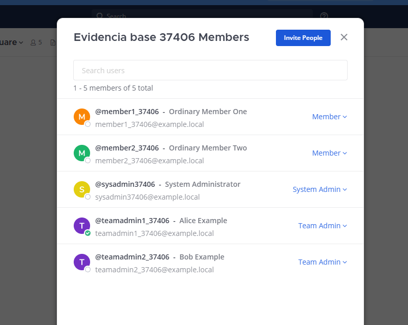
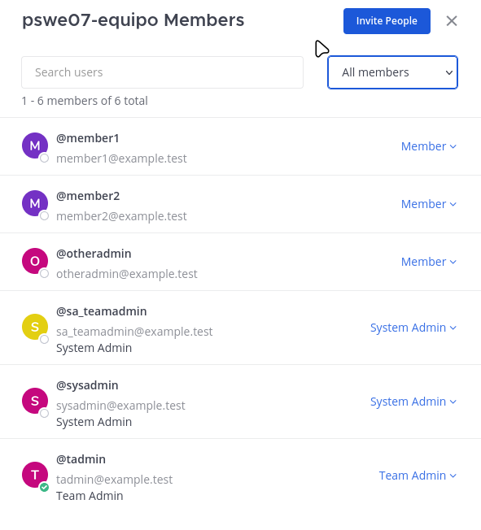
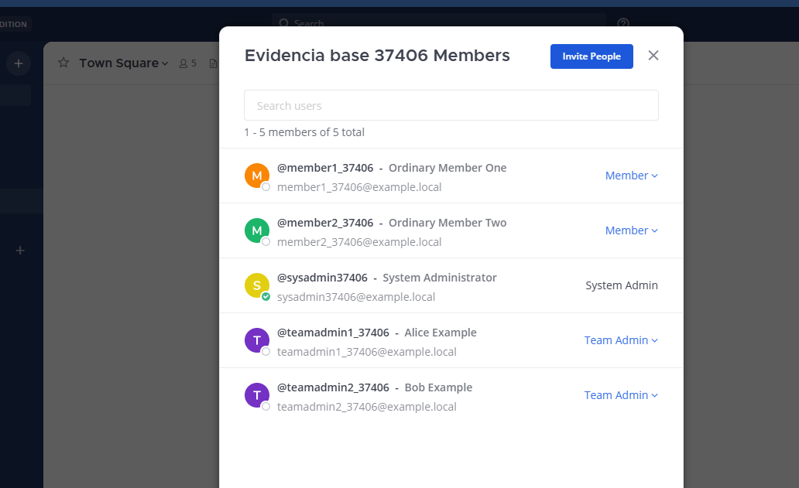
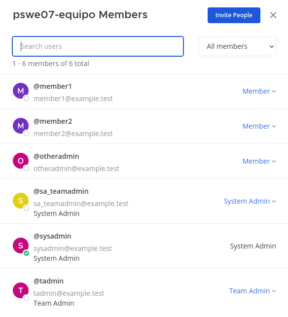

# Evidencia del incremento 1 (#37406): identificación y filtro de Team Admins

Tarea [TA-04 / #13](https://github.com/agvor/mattermost/issues/13). Historia [TA / #4](https://github.com/agvor/mattermost/issues/4).

## 1. Versión probada

| Elemento | Valor |
|---|---|
| Repositorio / rama | `agvor/mattermost`, `master` |
| SHA | `38555bc2` (incluye TA-02, PR #22, y TA-03, PR #23) |
| CI en `master` | [ejecución 40946449657](https://github.com/agvor/mattermost/actions/runs/40946449657), `success` |
| Cambios | Solo web (`webapp/channels`); el servidor no cambió |
| Ambiente | Mattermost local en `http://localhost:8065`, equipo de prueba `pswe07-equipo` (6 miembros) |
| Fecha | 3 de noviembre de 2026 |

Usuarios de prueba: `member1` y `member2` (miembros comunes), `tadmin` (Team Admin), `sysadmin` (System Admin), `sa_teamadmin` (System Admin que además es Team Admin) y `otheradmin` (Team Admin de otro equipo, miembro común aquí).

## 2. Antes y después

El estado base se documentó en [evidencia-base/issue-37406](../../evidencia-base/issue-37406/README.md): un miembro común veía la lista de miembros sin ninguna indicación de quién administra el equipo.

| Rol | Antes | Después |
|---|---|---|
| Miembro común |  |  |
| Team Admin |  |  |
| System Admin |  |  |

## 3. Recorrido por roles (después)

| # | Rol | Qué se comprueba | Captura |
|---|---|---|---|
| 1 | Miembro | Etiquetas Team Admin y System Admin visibles; sin menú de gestión | [01](capturas/01-miembro-lista-completa.png) |
| 2 | Miembro | Filtro "Admins": tadmin, sysadmin y sa_teamadmin | [02](capturas/02-miembro-filtro-admins.png) |
| 3 | Miembro | Filtro + búsqueda `member`: lista vacía | [03](capturas/03-miembro-filtro-vacio.png) |
| 4 | Miembro | Filtro + búsqueda `tadmin`: solo ese usuario | [04](capturas/04-miembro-filtro-busqueda.png) |
| 5 | Miembro | Vuelta a "All members": 6 miembros, sin cambios | [05](capturas/05-miembro-vuelta-todos.png) |
| 6 | Team Admin | Mismas etiquetas; el menú de gestión sigue funcionando | [06](capturas/06-teamadmin-lista-gestion.png) |
| 7 | Team Admin | Filtro "Admins" con menú de gestión | [07](capturas/07-teamadmin-filtro.png) |
| 8 | System Admin | Mismas etiquetas y menú de gestión (salvo en la fila propia, comportamiento previo) | [08](capturas/08-sysadmin-lista-gestion.png) |
| 9 | System Admin | Filtro "Admins" | [09](capturas/09-sysadmin-filtro.png) |

Decisiones aplicadas (TA-01): D1 el filtro incluye a los System Admin del equipo; D2 etiqueta en la fila; D3 rol vía `team_roles=team_admin`; D4 un System Admin que también es Team Admin muestra "System Admin".

## 4. Pruebas

| Tipo | Resultado |
|---|---|
| Pruebas web locales (`member_list_team`, `searchable_user_list`, `team_members_modal`) | 3 suites, 23 pruebas aprobadas |
| CI de `master` (lint, tipos, pruebas, compilación) | Verde en `2d70b617` y en `38555bc2` |
| Comprobación de la API como miembro (`TA-01_comprobacion_api.py`) | 9 de 9 OK |
| Recorrido manual por roles | Tabla de la sección 3 |
| Prueba E2E automatizada (Playwright) | Pendiente; ver limitaciones |

## 5. Versión entregada

Web reconstruida desde `master` en `38555bc2` y servida por el servidor local existente. La guía de despliegue y recuperación está en [CI_CD.md](../../github/CI_CD.md).

## 6. Limitaciones

- No se automatizó un spec de Playwright para esta pantalla; la verificación E2E se cubrió con el script de API y el recorrido manual.
- La paginación del filtro con más de 50 administradores está cubierta por pruebas automatizadas (55 administradores), no manualmente.

## 7. Uso de IA

Redacción de este documento asistida por IA (Claude); el recorrido, las capturas y las comprobaciones las hizo el equipo.